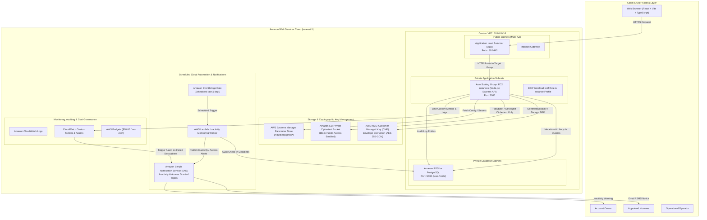

# VaultKeep System Architecture & AWS Infrastructure Specification

## 1. High-Level Architecture Overview

VaultKeep is an enterprise-grade, cloud-native digital legacy and nominee access platform. The system is designed to provide cryptographically enforced, conditional, time-delayed document access using persistent compute on Amazon EC2, managed relational metadata in Amazon RDS for PostgreSQL, private object storage in Amazon S3, envelope encryption protected by AWS Key Management Service (KMS), and serverless automation via Amazon EventBridge and AWS Lambda.

---

## 2. Network Topology & VPC Segmentation

The AWS VPC is partitioned into three distinct network tiers across two Availability Zones for fault tolerance:

| Subnet Tier | CIDR Block (AZ-a) | CIDR Block (AZ-b) | Route Table Destination | Access Level | Workload Hosted |
| :--- | :--- | :--- | :--- | :--- | :--- |
| **Public Subnets** | `10.0.1.0/24` | `10.0.2.0/24` | `0.0.0.0/0` -> Internet Gateway | Direct Public Ingress | Application Load Balancer (ALB) |
| **Private App Subnets** | `10.0.11.0/24` | `10.0.12.0/24` | Internal / VPC Endpoints | Isolated Compute | EC2 Auto Scaling Group Instances |
| **Private DB Subnets** | `10.0.21.0/24` | `10.0.22.0/24` | Local VPC Only | Zero Internet Access | Amazon RDS for PostgreSQL Multi-AZ |

### Security Group Ingress / Egress Matrix

1. **`ALBSecurityGroup`**:
   - Ingress: TCP 80 (HTTP) & TCP 443 (HTTPS) from `0.0.0.0/0`.
   - Egress: TCP 5000 to `AppSecurityGroup`.
2. **`AppSecurityGroup`**:
   - Ingress: TCP 5000 restricted strictly to `ALBSecurityGroup`. Management ports (SSH/22) are blocked; management is performed via AWS Systems Manager Session Manager.
   - Egress: TCP 5432 to `DBSecurityGroup`, HTTPS 443 to AWS API Endpoints (S3, KMS, SSM, CloudWatch).
3. **`DBSecurityGroup`**:
   - Ingress: TCP 5432 restricted strictly to `AppSecurityGroup` and `LambdaSecurityGroup`.
   - Egress: None (Isolated database tier).

---

## 3. Data Segregation: S3 Ciphertext vs RDS Metadata

To maintain zero-trust document security and database performance:
- **Amazon S3** stores ONLY authenticated ciphertext bytes. Filenames are anonymized into safe UUID storage keys (`vault/{ownerId}/{documentUuid}.enc`).
- **Amazon RDS** stores relational metadata, user identities, hashed passwords (bcrypt), nominee invitations, check-in timestamps, lifecycle states, release rules, release grants, and structured audit logs.
- Plaintext document bytes and raw plaintext Data Encryption Keys (DEKs) are **never** stored in the database.
