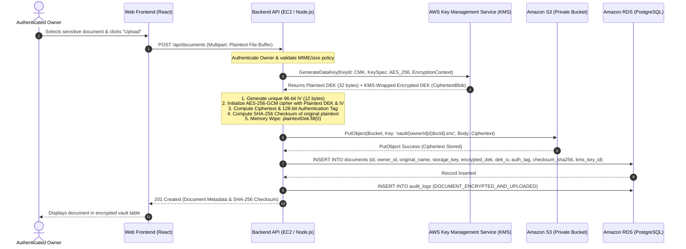
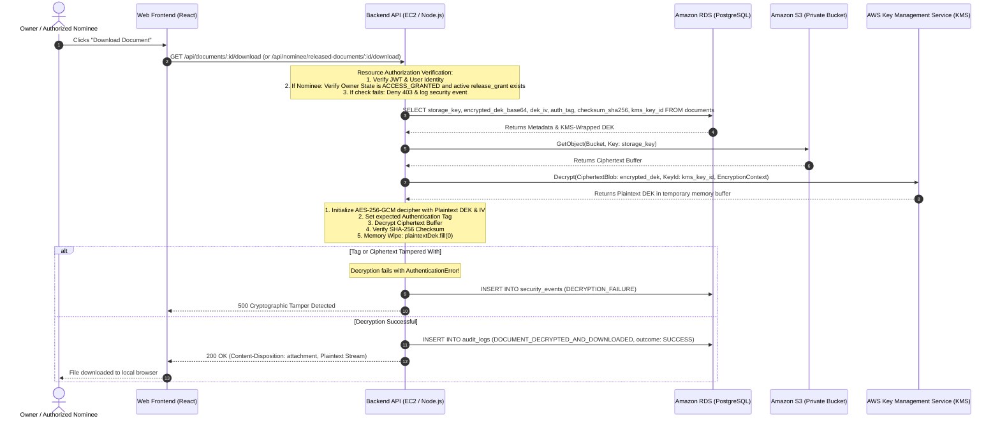

# VaultKeep Envelope Encryption Specification & Cryptographic Data Flow

## 1. Cryptographic Design Principles

VaultKeep enforces client/document-level envelope encryption prior to storing any object in cloud storage. The implementation guarantees that:
1. **The AWS KMS Customer Managed Key (CMK) raw key material never leaves AWS KMS hardware security modules (HSMs).**
2. **Every document is encrypted with a unique, cryptographically random 256-bit Data Encryption Key (DEK).**
3. **Authenticated Encryption (AES-256-GCM)** is used to provide confidentiality, authenticity, and tamper detection.
4. **Zero-Plaintext Persistence**: Neither plaintext document contents nor plaintext DEKs are ever stored in PostgreSQL, Amazon S3, configuration parameters, or application logs.
5. **Memory Sanitization**: Plaintext DEK buffers in Node.js runtime memory are explicitly wiped (`plaintextDek.fill(0)`) immediately upon completion of encryption or decryption operations.

---

## 2. Document Upload & Encryption Sequence

---

## 3. Document Download & Decryption Sequence (Owner / Authorized Nominee)

---

## 4. Cryptographic Parameter Reference

| Component | Standard / Value | Purpose |
| :--- | :--- | :--- |
| **KMS Master Key (CMK)** | Customer Managed Key (Symmetric) | Wraps and un-wraps Document Data Encryption Keys |
| **Data Encryption Key (DEK)** | 256-bit Cryptographic Random | Encrypts document file contents in memory |
| **Cipher Algorithm** | AES-256-GCM (Authenticated) | Guarantees confidentiality and message integrity |
| **Initialization Vector (IV)** | 96-bit (12 bytes) Cryptographic Nonce | Unique per encryption operation; never reused with same DEK |
| **Authentication Tag** | 128-bit (16 bytes) | Verifies ciphertext was not modified or corrupted |
| **Data Integrity Check** | SHA-256 Hash | Plaintext checksum validated post-decryption |
| **Memory Sanitization** | `Buffer.fill(0)` | Overwrites plaintext key buffer before garbage collection |
