# VaultKeep Database Schema & Entity-Relationship Model

## 1. Relational Database Overview

VaultKeep utilizes Amazon RDS for PostgreSQL as its transactional metadata datastore. The schema is normalized (3NF), enforces relational constraints, utilizes foreign key cascading, and separates application metadata from raw encrypted objects.

---

## 2. Entity-Relationship Diagram (ERD)

```mermaid
erDiagram
    users ||--o{ owner_settings : "configures"
    users ||--o{ nominees : "appoints"
    users ||--o{ documents : "owns"
    users ||--o{ check_ins : "performs"
    users ||--|| account_lifecycle : "tracked by"
    users ||--o{ document_release_rules : "defines"
    users ||--o{ notifications : "receives"
    users ||--o{ audit_logs : "initiates"

    nominees ||--o{ document_release_rules : "designated in"
    nominees ||--o{ release_grants : "receives"
    
    documents ||--o{ document_release_rules : "governed by"
    documents ||--o{ release_grants : "released through"

    users {
        uuid id PK
        string name
        string email UK
        string password_hash
        string role "OWNER | NOMINEE | ADMIN"
        string account_status "ACTIVE | SUSPENDED | CLOSED"
        boolean contact_verified
        timestamptz last_check_in_at
        timestamptz created_at
    }

    owner_settings {
        uuid id PK
        uuid owner_id FK
        int check_in_interval_days
        int grace_period_days
        int warning_days
        boolean reminder_email_enabled
        boolean reminder_sms_enabled
        string timezone
    }

    nominees {
        uuid id PK
        uuid owner_id FK
        uuid nominee_user_id FK
        string full_name
        string email
        string phone
        string relationship_type
        string invitation_token_hash
        string invitation_status "PENDING | ACCEPTED | DECLINED | REVOKED"
        timestamptz invitation_expires_at
        timestamptz verified_at
    }

    documents {
        uuid id PK
        uuid owner_id FK
        string original_name
        string storage_key UK "S3 Object Key"
        string mime_type
        bigint file_size_bytes
        string category "FINANCIAL | LEGAL | PERSONAL | CREDENTIALS | OTHER"
        string upload_status "UPLOADED | ARCHIVED | DELETED"
        string encryption_algorithm "AES-256-GCM"
        string encryption_version "v1"
        string kms_key_id
        text encrypted_dek_base64
        string dek_iv_base64
        string auth_tag_base64
        string checksum_sha256
    }

    document_release_rules {
        uuid id PK
        uuid owner_id FK
        uuid document_id FK
        uuid nominee_id FK
        string rule_status "ACTIVE | SUSPENDED | REVOKED"
        int access_duration_days
        timestamptz confirmed_at
    }

    check_ins {
        uuid id PK
        uuid owner_id FK
        timestamptz check_in_timestamp
        string check_in_type "MANUAL_DASHBOARD | EMAIL_LINK | API"
        string ip_address
        text user_agent
        timestamptz next_deadline_at
    }

    account_lifecycle {
        uuid id PK
        uuid owner_id FK
        string current_state "ACTIVE | CHECK_IN_DUE | GRACE_PERIOD | ACCESS_GRANTED"
        timestamptz last_successful_check_in
        timestamptz next_check_in_deadline
        timestamptz flagged_inactive_at
        timestamptz grace_period_ends_at
        string release_execution_state "NONE | SCHEDULED | EXECUTED | FAILED"
        text state_transition_reason
    }

    release_grants {
        uuid id PK
        uuid owner_id FK
        uuid nominee_id FK
        uuid nominee_user_id FK
        uuid document_id FK
        uuid rule_id FK
        string grant_status "ACTIVE | EXPIRED | REVOKED"
        timestamptz granted_at
        timestamptz expires_at
    }

    notifications {
        uuid id PK
        string recipient_email
        string recipient_role
        string notification_type
        uuid owner_id FK
        uuid event_reference_id
        string delivery_status "CREATED | PUBLISHED | PROVIDER_ACCEPTED | DELIVERED | FAILED"
        string provider_message_id
        text error_message
    }

    audit_logs {
        uuid id PK
        uuid actor_id FK
        string actor_email
        string actor_role
        string action
        string resource_type
        string resource_id
        string outcome "SUCCESS | FAILURE | DENIED"
        string ip_address
        string correlation_id
        jsonb metadata
        timestamptz created_at
    }
```

---

## 3. Database Indexes & Query Optimizations

| Table | Index Name | Indexed Columns | Justification |
| :--- | :--- | :--- | :--- |
| `users` | `idx_users_email` | `email` (Unique) | Rapid authentication & login lookups |
| `nominees` | `idx_nominees_owner` | `owner_id` | Fast fetching of owner's nominee directory |
| `nominees` | `idx_nominees_token` | `invitation_token_hash` | O(1) invitation token acceptance lookups |
| `documents` | `idx_documents_owner` | `owner_id` | Document vault listing filtered by authenticated owner |
| `documents` | `idx_documents_cat` | `category` | Vault category filtering (Financial, Legal, Personal) |
| `account_lifecycle` | `idx_lifecycle_state` | `current_state` | Fast querying of overdue accounts by EventBridge / Lambda |
| `account_lifecycle` | `idx_lifecycle_deadline` | `next_check_in_deadline` | Time-based range query for check-in expiration |
| `release_grants` | `idx_grants_nominee_doc` | `nominee_id, document_id` | Resource authorization verification on download requests |
| `audit_logs` | `idx_audit_logs_actor` | `actor_id, created_at DESC` | Paginated audit log review for compliance |
