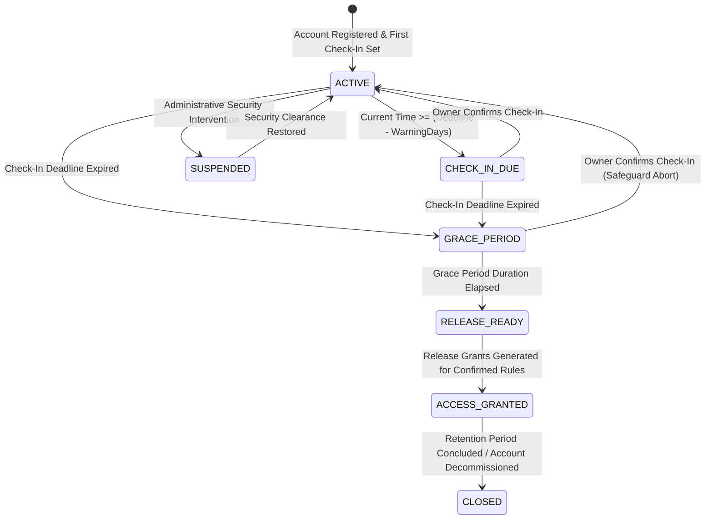

# VaultKeep Account Lifecycle State Machine & Inactivity Automation

## 1. Lifecycle State Machine Diagram



---

## 2. Comprehensive Lifecycle States Description

| State | Trigger / Condition | Access Control & Behavior | Safeguard & Actions |
| :--- | :--- | :--- | :--- |
| **`ACTIVE`** | Initial state or owner confirmed check-in | Documents are private to owner. Nominees have **zero access**. | `next_check_in_deadline` set to `now + check_in_interval_days`. |
| **`CHECK_IN_DUE`** | Current time passes warning threshold (e.g. 5 days prior to deadline) | Documents remain private. | Automated reminder notification dispatched to owner via SNS. |
| **`GRACE_PERIOD`** | Current time passes `next_check_in_deadline` | Documents remain **strictly locked**. Nominees cannot download files. | Inactivity notice dispatched to nominees. Urgent alert to owner. `grace_period_ends_at` running. **Owner check-in aborts release!** |
| **`RELEASE_READY`** | Current time passes `grace_period_ends_at` | Release worker acquires database lock (`FOR UPDATE`). | Validates confirmed release rules and verifies no check-in occurred. |
| **`ACCESS_GRANTED`** | Release grants generated in database | Nominees can authenticate and download explicitly assigned documents. | SNS `ACCESS_GRANTED` notice dispatched. Every download is cryptographically audited. |
| **`SUSPENDED`** | Repeated security anomalies or operator action | All access frozen. | Requires administrative intervention to restore. |

---

## 3. Inactivity Detection Automation Algorithm

The inactivity detection logic runs on an automated schedule (EventBridge + Lambda in cloud; background worker in local demo):

```
FOR EACH account IN account_lifecycle:
  IF account.status == 'ACTIVE' AND now() >= account.next_check_in_deadline:
    BEGIN TRANSACTION
      UPDATE account_lifecycle SET current_state = 'GRACE_PERIOD',
                                  flagged_inactive_at = now(),
                                  grace_period_ends_at = now() + owner_settings.grace_period_days
      INSERT INTO notifications (OWNER_FLAGGED_INACTIVE -> nominees)
      INSERT INTO notifications (INACTIVITY_WARNING -> owner)
      INSERT INTO audit_logs (LIFECYCLE_TRANSITION_GRACE_PERIOD)
    COMMIT TRANSACTION

  ELSE IF account.status == 'GRACE_PERIOD' AND now() >= account.grace_period_ends_at:
    BEGIN TRANSACTION
      UPDATE account_lifecycle SET current_state = 'ACCESS_GRANTED',
                                  release_execution_state = 'EXECUTED'
      FOR EACH rule IN document_release_rules WHERE owner_id = account.owner_id AND rule_status = 'ACTIVE':
        INSERT INTO release_grants (owner_id, nominee_id, document_id, rule_id, status = 'ACTIVE')
          ON CONFLICT (nominee_id, document_id) DO NOTHING
        INSERT INTO notifications (ACCESS_GRANTED -> nominee)
      INSERT INTO audit_logs (LIFECYCLE_TRANSITION_ACCESS_GRANTED)
    COMMIT TRANSACTION
```

---

## 4. Race Condition & Idempotency Safeguards

1. **Owner Check-In Precedence**: When an owner calls `POST /api/check-ins`, the transaction updates `account_lifecycle` immediately, setting `current_state = 'ACTIVE'` and clearing `grace_period_ends_at`. If the scheduled worker runs concurrently, it checks the state within a database row-level lock (`FOR UPDATE`), preventing any stale release.
2. **Idempotent Grant Insertion**: Release grants enforce a database unique constraint `uq_release_grant (nominee_id, document_id)` with `ON CONFLICT DO NOTHING`. Multiple scheduled runs cannot duplicate grants.
3. **Audit Trail Completeness**: Every transition creates an immutable audit record containing previous and new state, transition reason, and correlation ID.
